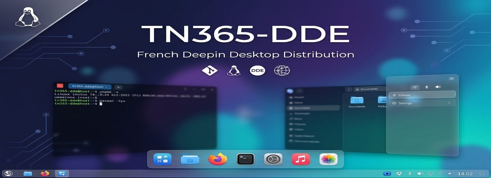

 
# TN365-DDE
 
French Deepin Desktop Distribution based on Ubuntu LTS
TN365-DDE is a Linux distribution project based on Ubuntu LTS and the Deepin Desktop Environment (DDE).
Vision

TN365-DDE aims to provide a modern, elegant, and user-friendly desktop experience with a strong focus on stability, simplicity, and French localization.
Features

    Ubuntu LTS base
    Deepin Desktop Environment (DDE)
    TN365 branding
    Custom wallpapers and themes
    Calamares installer
    Long-term maintenance

Components

    Deepin Desktop Environment
    Vivaldi Browser
    TN365 Wallpapers
    TN365 Tools
    TN365 Branding Packages

Roadmap

    Create TN365 branding packages
    Build TN365 APT repository
    Package DDE components
    Release first TN365-DDE ISO
    Provide French community support

Project Status

Early development.
Links

    GitHub: https://github.com/webmasterdu63-creator/TN365-DDE
    SourceForge: Coming soon

License
GPL-3.0

# TN365-DDE
TN365-DDE - French Deepin Desktop Distribution based on Ubuntu LTS
TN365-DDE

TN365-DDE est une distribution Linux francophone basée sur Ubuntu LTS et l'environnement Deepin Desktop Environment (DDE).
Objectifs

    Bureau Deepin moderne
    Localisation française
    Outils TN365
    Thèmes et fonds d'écran TN365
    Distribution simple et élégante

Base technique

    Ubuntu LTS
    Deepin Desktop Environment
    Dépôt APT TN365
    Installation Calamares
Upstream Components

    dde-control-center
    dde-dock
    dde-file-manager
    dde-launchpad
    dde-session-shell

Maintained through official Deepin forks.
État du projet
En développement.
